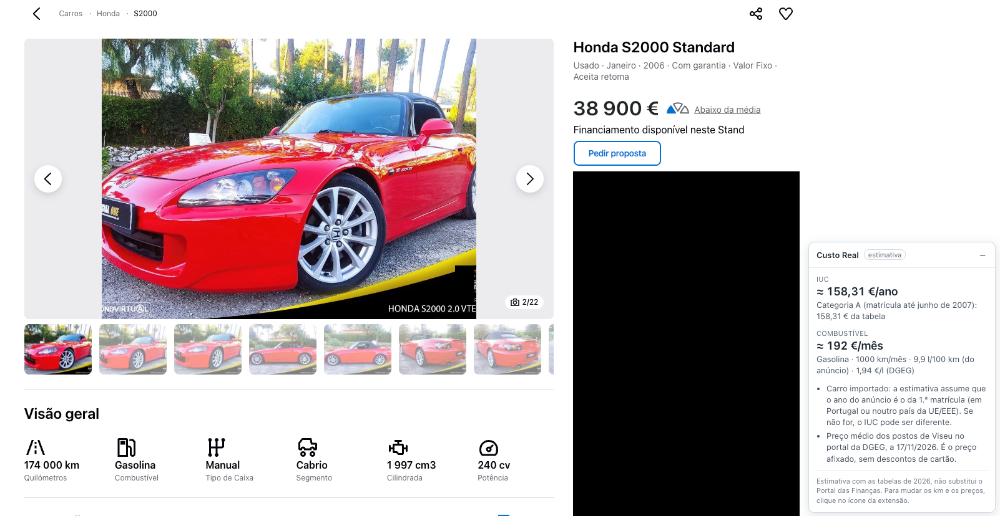
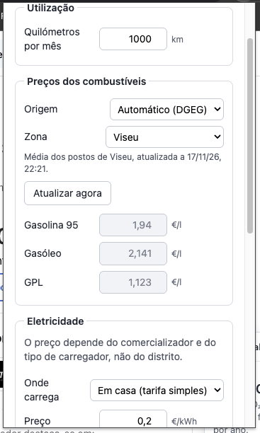
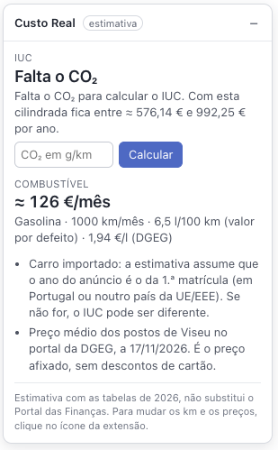

# Custo Real

Extensão para o Chrome (também funciona no Edge e no Brave) que mostra, em cada anúncio de carro do Standvirtual, uma estimativa do **IUC anual** e do **custo mensal de combustível**.

Projeto independente, não afiliado ao Standvirtual nem à DGEG. Os preços dos combustíveis vêm do portal público da DGEG e os dados do anúncio são lidos da página aberta no browser.

Quem compra um carro usado olha para o preço, mas o custo verdadeiro inclui o imposto de todos os anos e o combustível. O painel faz essas contas na própria página do anúncio.

## O que mostra

- **IUC anual estimado**, com as parcelas do cálculo (cilindrada, CO₂, coeficiente do ano, adicional do gasóleo).
- **Custo mensal de combustível**, a partir do consumo do anúncio ou de um consumo por defeito, dos quilómetros por mês e dos preços definidos nas opções.
- Quando falta um dado, diz qual é em vez de inventar um valor. Se faltar o CO₂, mostra o intervalo possível e deixa escrevê-lo no painel.

- **Anúncios de comerciais**: o custo de combustível é calculado e, para o IUC, usa o valor que o stand indica no anúncio quando existe. Sem esse valor diz que não estima, porque o IUC dos comerciais depende do peso bruto.

Todos os valores são estimativas e aparecem com `≈`.

## Capturas de ecrã





## Instalar

**Chrome Web Store**: a ligação fica aqui quando a extensão estiver publicada.

### Em modo de programador

1. Abrir `chrome://extensions`.
2. Ligar o **Modo de programador** (canto superior direito).
3. Clicar em **Carregar expandida** e escolher a pasta do projeto (a que tem o `manifest.json`).
4. Abrir um anúncio em `https://www.standvirtual.com`.

As opções (km por mês, preços, consumos por defeito) abrem ao clicar no ícone da extensão.

Depois de alterar o código: recarregar a extensão em `chrome://extensions` e recarregar a página do anúncio.

### Gerar o ficheiro para a loja

```bash
bash scripts/pack.sh
```

Cria `dist/custo-real-<versão>.zip` só com o `manifest.json`, `src` e `icons`, que é o que a Chrome Web Store precisa.

## Testes

```bash
npm install
npm test
```

Os testes usam Jest e cobrem o normalizador, o cálculo do IUC, o custo de combustível, o adaptador do Standvirtual e os textos do painel. Os casos em `tests/fixtures` vêm de anúncios reais.

## Como está organizado

```
manifest.json
src/
  content.js               liga as peças: adaptador → normalizador → cálculos → painel
  background.js            service worker: vai buscar os preços à DGEG e guarda-os em cache
  sites/standvirtual.js    só conhece o site: extrai os dados brutos do anúncio
  core/normalizeCar.js     transforma os dados brutos numa estrutura sempre igual
  core/iuc.js              cálculo do IUC
  core/iuc-tables-2026.js  tabelas do IUC (só dados)
  core/fuelCost.js         custo mensal de combustível
  core/defaults.js         opções por defeito e valores de referência do kWh
  core/prices.js           escolhe entre preços automáticos e manuais
  data/dgeg.js             cliente da DGEG: lê postos, tira a média por distrito
  ui/panelText.js          textos do painel
  ui/panel.js              painel em Shadow DOM
  options/                 página de opções
tests/
```

Três camadas separadas:

1. **Adaptador do site**: lê o JSON que o Standvirtual embute na página (`__NEXT_DATA__`). Para suportar outro site basta criar outro ficheiro em `src/sites`.
2. **Normalizador**: função pura que trata formatos como `1 598 cm3`, `15 000 km`, `5,4 l/100km` ou `03/2015`. O que não existe fica a `null`.
3. **Cálculos**: funções puras que recebem o carro normalizado e as opções.

Não há passo de build nem frameworks: é JavaScript simples, Manifest V3.

## Regras do IUC usadas (2026)

Valores do Código do IUC na redação da Lei n.º 82/2023. O Orçamento do Estado para 2026 (Lei n.º 73-A/2025) não atualizou as taxas, por isso os valores de 2026 são iguais aos de 2024 e 2025. O adicional do gasóleo é o do artigo 216.º da Lei n.º 82-B/2014, mantido em 2026.

- **100 % elétricos**: isentos (artigo 5.º).
- **1.ª matrícula anterior a 1981**: não pagam.
- **Categoria A** (1981 a 30 de junho de 2007): valor de tabela conforme o combustível, a cilindrada e a faixa de anos. Os carros a gasóleo pagam ainda o adicional.
- **Categoria B** (desde 1 de julho de 2007): `(taxa de cilindrada + taxa de CO₂ + taxa adicional de CO₂) × coeficiente do ano + adicional do gasóleo`.
  - A taxa adicional de CO₂ só se aplica a matrículas de 2017 em diante, nos dois escalões mais altos.
  - Coeficiente: 1,00 em 2007, 1,05 em 2008, 1,10 em 2009 e 1,15 de 2010 em diante.
- **Híbridos e híbridos plug-in**: pagam como os outros, conta o combustível do motor de combustão.
- **Abaixo de 10 €** o imposto não é cobrado (artigo 16.º).
- **Importados**: conta a 1.ª matrícula em Portugal ou noutro país da UE/EEE (Lei n.º 119/2019).

Para atualizar as tabelas noutro ano: copiar `src/core/iuc-tables-2026.js`, mudar os valores e trocar o nome do ficheiro no `manifest.json` e no `iuc.js`.

### Fontes

- Código do IUC, Portal das Finanças: <https://info.portaldasfinancas.gov.pt/pt/informacao_fiscal/codigos_tributarios/iuc/Pages/codigo-do-iuc-indice.aspx> (artigos 2.º, 5.º, 9.º, 10.º e 16.º, e a página do adicional de IUC).
- No Portal das Finanças as tabelas dos artigos 9.º e 10.º são imagens. Os valores foram transcritos e cruzados com a DECO PROteste, "Tabelas IUC 2026: quanto paga?" (<https://www.deco.proteste.pt/dinheiro/impostos/noticias/tabelas-iuc-quanto-paga>) e com a transcrição da lei no informador.pt.
- Os exemplos de cálculo da DECO (111,46 € e 158,29 €) fazem parte dos testes.

## Limitações da estimativa

- **CO₂**: muitos anúncios não o indicam. Sem ele não há valor para a categoria B, só o intervalo possível. O valor certo está no campo V.7 do Documento Único Automóvel.
- **NEDC ou WLTP**: o anúncio não diz como o CO₂ foi medido. A extensão assume NEDC até 2017 e WLTP desde 2020. Em 2018 e 2019 calcula os dois e mostra o intervalo quando dão valores diferentes.
- **Importados**: assume que o ano do anúncio é o da 1.ª matrícula. Se for o da matrícula portuguesa, o IUC real pode ser diferente.
- **2007 sem mês**: não dá para saber se é categoria A ou B, por isso mostra o intervalo.
- **Mínimo de 10 €**: é aplicado ao total, já com o adicional do gasóleo.
- **Não cobre**: comerciais e mistos acima de 2500 kg (categorias C e D; nos anúncios de comerciais só se mostra o IUC que o anunciante indicar), motos, táxis, isenção por incapacidade igual ou superior a 60 %, veículos de interesse histórico (apenas avisa que a isenção pode existir).
- **Combustível**: o consumo anunciado é o de homologação, o real costuma ser mais alto. Nos híbridos plug-in o custo não é estimado. No GPL assume-se que o carro circula sempre a GPL.
- As tabelas são as de 2026 e têm de ser atualizadas à mão quando mudarem.

Em caso de dúvida, o valor que conta é o do Portal das Finanças.

## Preços por defeito

Em modo automático (o predefinido) os combustíveis usam a média dos postos da DGEG no distrito escolhido, ou a média do continente se não houver distrito. Se a DGEG não responder, ficam os valores manuais abaixo. A média é a dos preços afixados nos postos, sem descontos de cartão, e as regiões autónomas não estão incluídas.

A eletricidade não é automática: o preço depende do comercializador e do tipo de carregador, não do distrito. As opções têm valores de referência (casa 0,20 €/kWh, público normal 0,19, rápido 0,28 e ultrarrápido 0,40) que se podem alterar. Os do público são preços médios por tipo de posto publicados pela Repsol, os de casa são a média da tarifa regulada de 2026 da ERSE.

Valores manuais de referência de novembro de 2026, que cada pessoa deve ajustar nas opções:

- Gasolina 1,95 €/l, gasóleo 2,15 €/l e GPL 1,00 €/l: médias diárias da DGEG em <https://precoscombustiveis.dgeg.gov.pt>.
- Eletricidade 0,20 €/kWh: tarifa regulada simples (0,1654 €/kWh mais IVA), para quem carrega em casa. Nos postos públicos o preço é mais alto. Simulador da ERSE: <https://www.erse.pt>.

## Privacidade

- Permissões: `storage` e acesso a `https://www.standvirtual.com/*` e a `https://precoscombustiveis.dgeg.gov.pt/*`.
- Não recolhe dados, não tem servidores próprios e não tem analytics.
- Há dois pedidos de rede. Ao Standvirtual: quando o site muda de anúncio sem recarregar a página, a extensão pede o HTML do anúncio que está aberto para ler os dados dele. À DGEG: no máximo de 12 em 12 horas, para ler os preços dos postos. Este pedido não leva nada do utilizador nem do anúncio. No modo manual não é feito.
- As opções são guardadas com `chrome.storage.sync`, no perfil do browser de quem a usa.

## Desenvolvimento

Os valores do IUC foram confirmados nas fontes acima e os casos de teste vêm de anúncios reais.

A política de privacidade está em [PRIVACY.md](PRIVACY.md).

## Próximas versões

- Painel dentro da página, junto ao preço (hoje é flutuante).
- OLX e outros sites.
- Custo total a 3 anos.
- Alertas (quilómetros suspeitos, preço anormal).
- Comparação de carros lado a lado.
